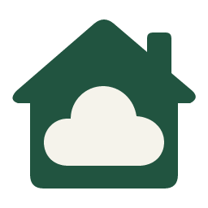

# ThuisWeb

**Je eigen website op Unraid of Docker.** ThuisWeb draait HTML en PHP met Apache, in een eigen container per website.

## Installeren op Unraid

1. Zoek **ThuisWeb** in Unraid **Apps** en kies **Install**.
2. Kies een vrije poort en een map voor je website. De standaardinstellingen staan hieronder.
3. Open **WebUI** en plaats je websitebestanden in de websitemap. Vervang `index.html` of voeg `index.php` toe; PHP heeft voorrang.

Een lege websitemap krijgt een startpagina met live statusbolletjes en de versies van Apache, PHP en OPcache. Bestaande websitebestanden blijven behouden.

| Instelling | Standaard |
| --- | --- |
| Webpoort | `8583` → `8080` |
| Websitemap | `/mnt/user/appdata/thuisweb/www` → `/var/www/html` |
| Configuratiemap | `/mnt/user/appdata/thuisweb/config` → `/config` |
| PHP-geheugen / uploadlimiet | `256M` / `32M` |
| PUID / PGID | `99` / `100` |

Nog niet zichtbaar in Apps? Voeg de container toe via **Docker → Add Container** met image `ghcr.io/marcvandecoevering/thuisweb:php8.3`, netwerk **bridge** en de poort- en mapkoppelingen hierboven.

## Zonder Unraid: Docker op Windows of Linux

Gebruik het meegeleverde [Docker Compose-bestand](compose.yaml). Met Docker Desktop draai je ThuisWeb lokaal op je Windows-pc. Volg de [Docker-handleiding](docs/docker.md) om te beginnen; een GitHub-account is niet nodig.

## Meer websites

Installeer ThuisWeb opnieuw met een andere containernaam, een vrije poort en eigen website- en configuratiemappen. Zo heeft iedere website zijn eigen plek.

## Handig om te weten

- PHP 8.3 en `.htaccess` worden ondersteund.
- Gebruik voor een domeinnaam met HTTPS je reverse proxy. Een database voeg je apart toe.
- Updates installeer je via Unraid. Maak een back-up van je website- en configuratiemappen en eventuele database.

[Handleiding](docs/handleiding.md) · [Vraag stellen of probleem melden](https://github.com/marcvandecoevering/ThuisWeb/issues) · [MIT-licentie](LICENSE)
